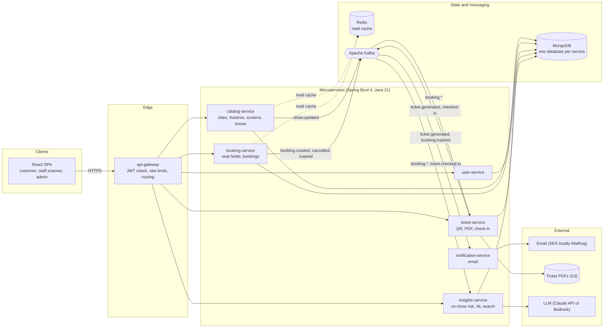

# CineBook

Movie theatre seat booking where you reserve online, **pay at the venue**, and walk in with a QR ticket from your inbox.

> **Status: planning.** The architecture, UI mockups and backlog are defined; implementation starts with the [POC milestone](#roadmap). Commands below describe the intended developer workflow and will be filled in as the services land.

## How it works

1. Pick a city, a movie and a showtime.
2. Choose seats on the seat map. They are held for a few minutes while you decide.
3. Confirm. Nothing is charged online; the amount is payable at the theatre counter.
4. A ticket PDF with a signed QR code arrives by email within seconds.
5. Staff scan the QR at the gate. A ticket works once.
6. Bookings you have not confirmed are released shortly before the show, so seats do not sit empty.

## Features

| Area | Highlights |
|---|---|
| Booking | Seat holds with expiry, atomic reservation (no double-booking), cancellation with cutoff, seat tiers |
| Tickets | Signed QR, PDF download, email delivery, wallet pass (planned) |
| Entry | Staff scanner PWA, single-use check-in, reuse detection |
| Scale | Multi-city, multi-theatre data model, tenant-scoped admin roles, screen layout designer |
| AI | No-show risk estimates with explanations, natural-language movie search |
| Operations | Outbox-based event delivery, dead-letter topics, tracing, infrastructure as code |

## Architecture

More diagrams (booking flow, check-in, seat release, booking lifecycle, AWS deployment) are in [docs/architecture.md](docs/architecture.md).

### Services

| Service | Responsibility |
|---|---|
| `api-gateway` | Single entry point: JWT validation, rate limiting, routing, correlation IDs |
| `user-service` | Accounts, login, roles, theatre-owner tenancy |
| `catalog-service` | Cities, theatres, screens, movies, shows, pricing |
| `booking-service` | Seat map, holds, bookings, cancellation, auto-release |
| `ticket-service` | Signed QR tokens, PDF tickets, check-in |
| `notification-service` | Ticket, reminder and release emails |
| `insights-service` | No-show risk and natural-language search; the only service that calls an LLM |

### Events

| Topic | Producer | Consumers |
|---|---|---|
| `booking.created` | booking-service | ticket-service, insights-service |
| `booking.cancelled` | booking-service | ticket-service, notification-service, insights-service |
| `booking.expired` | booking-service | notification-service, insights-service |
| `ticket.generated` | ticket-service | notification-service |
| `ticket.checked-in` | ticket-service | booking-service, insights-service |
| `show.updated` | catalog-service | booking-service, notification-service |

Events are keyed by `showId` so everything for one show stays ordered. Consumers are idempotent and failed messages go to `<topic>.dlq`.

## Tech stack

- **Backend:** Java 21, Spring Boot 4, Spring Cloud Gateway
- **Data:** MongoDB (database per service), Redis for read caching
- **Messaging:** Apache Kafka
- **Frontend:** React, TypeScript
- **AI:** LLM access (Claude API or Amazon Bedrock) isolated behind `insights-service`
- **Cloud:** AWS: ECS Fargate, MSK, MongoDB Atlas or DocumentDB, ElastiCache, S3, SES, Secrets Manager, CloudWatch
- **Testing:** JUnit, Testcontainers, Playwright

## UI mockups

Static HTML in [docs/mockups](docs/mockups/README.md): [home](docs/mockups/home.html), [movie](docs/mockups/movie.html), [seat picker](docs/mockups/seats.html), [ticket](docs/mockups/ticket.html), [my bookings](docs/mockups/bookings.html), [admin](docs/mockups/admin.html), plus mobile seat picker, ticket and staff scanner. Names, times and figures in the mockups are example data.

## Local development

Local development runs against a **MongoDB** and an **Apache Kafka** container you already have running. The repository does not start them for you.

Prerequisites:

- JDK 21, Node 20+
- MongoDB reachable on `localhost:27017`, started as a **replica set** (multi-document transactions are required for seat booking)
- Kafka reachable on `localhost:9092`
- Optional: Mailhog for viewing emails locally

Configuration is by Spring profile. `local` is the default and needs no AWS credentials. Defaults can be overridden with environment variables (the full list will be documented in the environment configuration issue):

| Variable | Local default |
|---|---|
| `MONGODB_URI` | `mongodb://localhost:27017/?replicaSet=rs0` |
| `KAFKA_BOOTSTRAP_SERVERS` | `localhost:9092` |
| `SPRING_PROFILES_ACTIVE` | `local` |

Run and test commands will be added when the workspace is created. Integration tests will use Testcontainers, so CI never depends on your local containers.

## Production on AWS

The `prod` profile reads all settings from environment variables, with secrets from AWS Secrets Manager. Services run on ECS Fargate behind an Application Load Balancer, the React build is served from S3 through CloudFront, and the data layer uses MSK for Kafka and MongoDB Atlas on AWS or DocumentDB for storage (a spike issue decides which). See the deployment diagram in [docs/architecture.md](docs/architecture.md#aws-production-deployment).

## Roadmap

Work is tracked in GitHub issues under three milestones:

| Milestone | Focus |
|---|---|
| **M1 POC** (weeks 1-2) | One city, one theatre, end to end: browse, hold, book, email ticket, check in, deployed to AWS |
| **M2 Core platform** (week 3) | Outbox and idempotency, cancellation and auto-release, reminders, staff scanner, admin tools, CI/CD |
| **M3 Scale and AI** (week 4) | Multi-city and multi-theatre, layout designer, no-show prediction, natural-language search, IaC, load testing |

The POC umbrella issue links every child issue.

## Design principles

- **No double-booking, ever.** Seat changes are conditional and atomic, and a concurrency test guards them.
- **Events are never lost.** State change and event commit together through an outbox.
- **Booking never depends on an LLM.** AI features degrade to a plain baseline.
- **Services own their data.** No cross-service database access.

## Contributing

1. Pick an issue from the current milestone and comment to claim it.
2. Branch from `main`, keep pull requests focused on one issue, and reference it (`Closes #n`).
3. Add or update tests; CI must pass.

## License

See [LICENSE](LICENSE).
