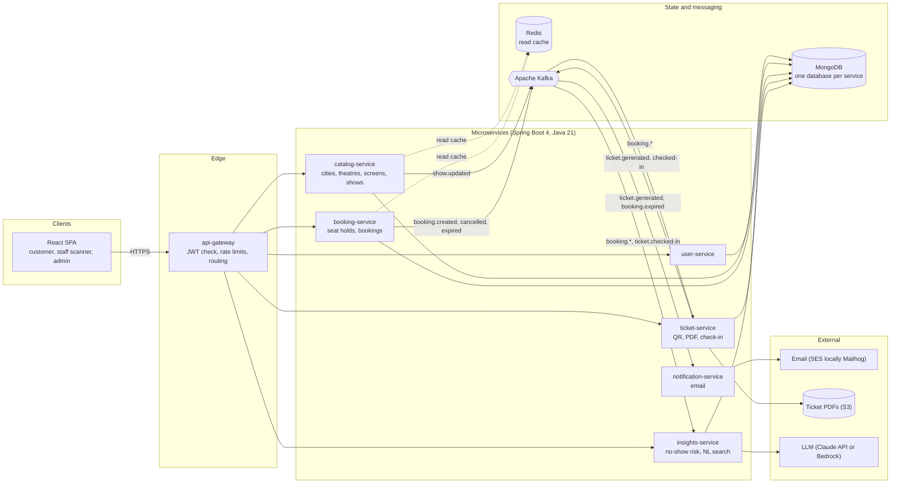
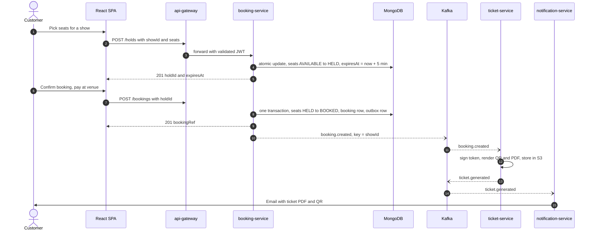
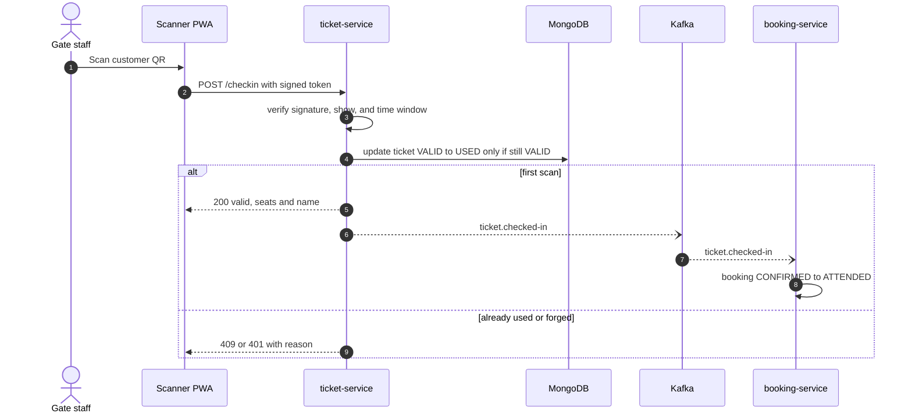
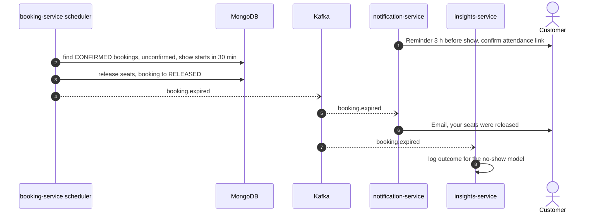
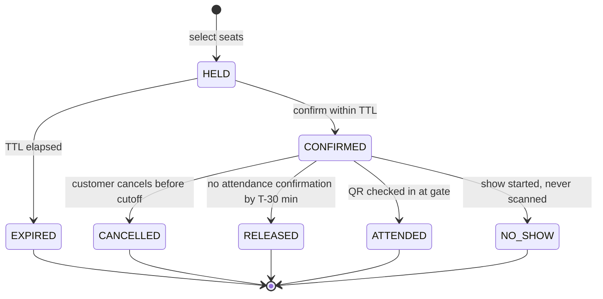
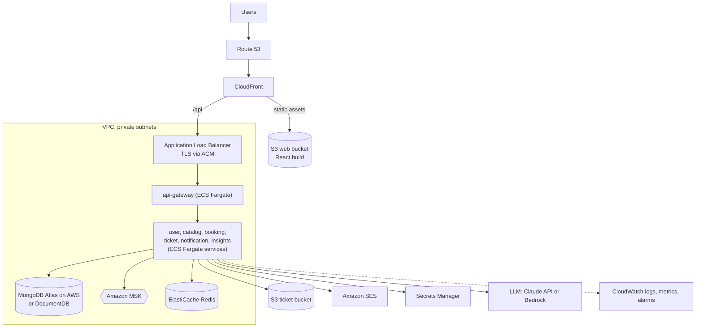

# CineBook architecture

Diagrams are Mermaid and render on GitHub. The same diagrams appear in the shareable overview page.

## System architecture

Every request enters through the gateway. Services never read each other's databases. They talk through Kafka events or the gateway-facing APIs.

## Booking flow

Seats are held first with a short TTL, then converted to a booking in one transaction that also writes the outbox row. Ticket and email work happens asynchronously.

## Check-in at the theatre

The conditional update is what makes a QR single-use: two scanners racing on one ticket, only one wins.

## Reminders and seat release

Pay-at-venue has no payment barrier, so unconfirmed bookings are released shortly before the show. The outcome feeds the no-show model.

## Booking lifecycle

Terminal states are EXPIRED, CANCELLED, RELEASED, ATTENDED and NO_SHOW.

## AWS production deployment

Local development uses the Mongo and Kafka containers already running on the developer machine. Production swaps in the managed services shown here, selected by Spring profile.

## Design decisions

| Decision | Why |
|---|---|
| Database per service, one Mongo cluster | Services own their data. No cross-service reads, so each can be scaled or moved independently. |
| Seat state is one document per show and seat | A conditional update (`status == AVAILABLE`) is atomic; multi-seat holds use a transaction, which needs a replica set locally and in prod. |
| Hold, then book | A hold has a short TTL (default 5 minutes) so an abandoned selection frees itself. Booking converts the hold in one transaction. |
| Transactional outbox | The booking row and the `booking.created` event commit together, so a crash cannot lose the event. |
| Kafka partition key = `showId` | All events for one show stay ordered, and parallelism comes from many shows. |
| Idempotent consumers | Every event carries an ID. Replays and retries never produce a second ticket or email. |
| Signed QR token | The gate can reject forged tickets without a database lookup, then does one conditional update to make it single-use. |
| Pay at venue means no-show risk | Unconfirmed bookings are released before the show (per-theatre policy), and the outcome trains the no-show estimate. |
| LLM only behind `insights-service` | One place to manage prompts, model IDs, timeouts, cost and fallbacks. Core booking never depends on an LLM call. |

## Kafka topics

| Topic | Producer | Consumers | Key |
|---|---|---|---|
| `booking.created` | booking-service | ticket-service, insights-service | showId |
| `booking.cancelled` | booking-service | ticket-service, notification-service, insights-service | showId |
| `booking.expired` | booking-service | notification-service, insights-service | showId |
| `ticket.generated` | ticket-service | notification-service | bookingRef |
| `ticket.checked-in` | ticket-service | booking-service, insights-service | showId |
| `show.updated` | catalog-service | booking-service, notification-service | showId |
| `<topic>.dlq` | any consumer | operators | original key |

## Environments

| | Local | Production |
|---|---|---|
| MongoDB | Container already running on the developer machine (replica set) | MongoDB Atlas on AWS or DocumentDB (see spike issue) |
| Kafka | Container already running on the developer machine | Amazon MSK |
| Email | Mailhog (optional) | Amazon SES |
| Secrets | Environment variables | AWS Secrets Manager |
| Spring profile | `local` (default) | `prod` |
